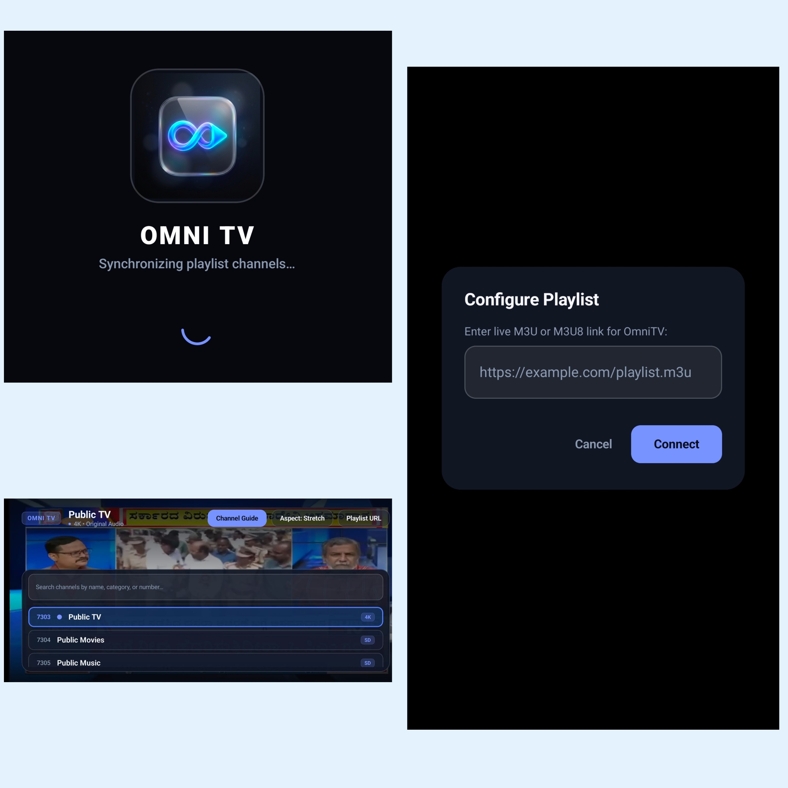

# OmniTV - IPTV Player for Android

<p align="center">
  
  
  
</p>

A lightweight IPTV streaming application built with Kotlin, Jetpack Compose, and AndroidX Media3 (ExoPlayer). Works across Android phones, tablets, and Android TV / Google TV / Fire TV devices.

---

## Screenshots

<p align="center">
  
</p>

---

## Device Compatibility

- **Android Phones**: Touch controls, sensor-based landscape orientation during playback, and automatic soft keyboard resizing.
- **Android Tablets**: Responsive layout, search, and channel guide navigation.
- **Android TV / Google TV / Fire TV**: Full D-Pad remote control support, channel switching, and remote shortcut keys.

---

## Playlist Configuration & Recommended Sources

OmniTV works with live M3U and M3U8 IPTV playlists.

### Recommended Playlist (by Creator)
For legal and freely available public channels, you can use the community-maintained [iptv-org](https://github.com/iptv-org/iptv.git) playlist:

- **Repository**: [https://github.com/iptv-org/iptv.git](https://github.com/iptv-org/iptv.git)
- **Playlist URL**:
  ```text
  https://iptv-org.github.io/iptv/index.m3u
  ```

> **Custom Playlists**: The above URL is recommended for initial setup, but you can enter your own custom M3U/M3U8 playlist URL in the **Playlist URL** dialog at any time.

---

## Features

- **5-Second Auto-Hide HUD**: Player controls, channel details, and top bar automatically fade out after 5 seconds of inactivity on both touch and TV remote, leaving an unobstructed full-screen stream.
- **Keep Screen Awake**: Automatic screen timeout is prevented during active viewing and channel navigation, automatically restoring normal device sleep behavior when leaving the app.
- **Adaptive 3G / 4G Cellular Streaming**: Integrated `DefaultBandwidthMeter`, 30s buffer cushion, and HLS live target offset to eliminate stuttering and buffering on low-speed mobile networks.
- **Translucent Glass UI**: Frosted glass panels styled for simple, distraction-free viewing.
- **TV Remote Navigation**:
  - **Left / Right**: Previous / Next channel.
  - **Up / Down**: Channel browsing or menu selection.
  - **Center / OK**: Open HUD overlay or tune selected channel.
  - **Green / Yellow / 0 / Audio Key**: Switch aspect ratio between Fit, Fill, and Stretch.
  - **Menu Key**: Open Playlist URL dialog.
- **Channel Search & Adaptive Layout**:
  - Search channels by name, group, or number in the channel guide.
  - In landscape mode on phones and tablets, the UI resizes when the keyboard opens so the search bar and results stay visible.
  - On TV remotes, pressing Down from the search box navigates directly into channel results.
  - Pressing Back clears the search text before closing the guide.
- **Orientation Behavior**:
  - Player forces landscape playback (flips to both landscape angles with device sensors).
  - Playlist URL input allows portrait mode for easier typing on phones.
- **Aspect Ratio Options**: Fit (original with letterbox), Fill (zoom to fill screen), and Stretch.
- **Lightweight Build**: Pre-compiled release APK is around 3.5 MB with unused code stripped via R8/ProGuard.

---

## Remote & Navigation Shortcuts

| Key / Input | Action |
| :--- | :--- |
| **D-Pad Center / OK / Enter** | Show overlay (auto-hides after 5s) / Tune channel |
| **D-Pad Left / Right** | Previous / Next channel |
| **D-Pad Up / Down** (Overlay closed) | Channel Up / Down |
| **D-Pad Up / Down** (Overlay open) | Move between search bar and channel list |
| **Green / Yellow / 0 / Audio Key** | Toggle Aspect Ratio (Fit, Fill, Stretch) |
| **Menu Button** | Open Playlist URL dialog |
| **Back Button** | Clear search text / Close overlay / Exit app |

---

## Installation

### Method 1: Download Pre-built APK from GitHub Releases

Download the latest production release APK from [GitHub Releases](https://github.com/RaidenX2905/OmniTV/releases/latest):

- **[Download OmniTV-v1.0.2-release.apk (Direct Release Asset)](https://github.com/RaidenX2905/OmniTV/releases/download/v1.0.2/OmniTV-v1.0.2-release.apk)** (~3.5 MB)

Works on Android phones, tablets, and Android TV / Google TV / Fire TV devices.

---

### Method 2: Sideload via Wireless ADB (Windows, Linux, macOS)

Connect your device and computer to the same Wi-Fi network, enable Developer Options and Network Debugging on your device, then run:

#### Windows
```cmd
adb connect <DEVICE_IP>:5555
adb install -r OmniTV-latest.apk
```

#### Linux
```bash
adb connect <DEVICE_IP>:5555
adb install -r OmniTV-latest.apk
```

#### macOS
```zsh
adb connect <DEVICE_IP>:5555
adb install -r OmniTV-latest.apk
```

---

## Architecture & Core Packages

OmniTV is engineered with a modern reactive Android stack focused on high performance and minimal memory footprint:

| Package / Module | Version | Purpose |
| :--- | :--- | :--- |
| **AndroidX Media3 ExoPlayer** | `1.5.0` | Ultra-low latency HLS, DASH, RTSP, and TS live stream playback engine |
| **Media3 OkHttp DataSource** | `1.5.0` | Fast connection pooling, HTTP/2 multiplexing, and robust stream timeouts |
| **Jetpack Compose UI** | `2024.11.00 (BOM)` | Hardware-accelerated UI rendering with 60 FPS translucent frosted glass components |
| **Jetpack Compose Material 3** | `1.3.x` | Modern styling, dynamic insets, and dark-theme palette system |
| **KotlinX Coroutines** | `1.9.0` | Non-blocking asynchronous I/O and non-freezing M3U playlist parsing |
| **AndroidX Activity Compose** | `1.9.3` | Back-press interception, edge-to-edge window insets, and IME software keyboard binding |
| **OkHttp3** | `4.12.0` | High-throughput HTTP client for downloading remote M3U/M3U8 playlists |

---

## Building from Source

Requires **JDK 21** and **Android SDK Platform 35**.

### Release APK (~3.5 MB)
```bash
./gradlew assembleRelease
```
Output: `app/build/outputs/apk/release/app-release.apk`

### Debug APK
```bash
./gradlew assembleDebug
```
Output: `app/build/outputs/apk/debug/app-debug.apk`

