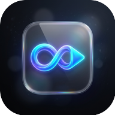

<p align="center">
  
</p>

<div align="center">

# OmniTV

[](#) [](#) [](#) [](#) [](#) [](#)

<p align="center">
  Hardware-accelerated IPTV media player for Android phones, tablets, and Android TV featuring a glassmorphic interface, channel search, and D-pad remote navigation.
</p>

</div>

---

**Live Demo**: [https://github.com/RaidenX2905/OmniTV/releases](https://github.com/RaidenX2905/OmniTV/releases)

---

## Highlights

- **Universal Screen Adaptation**: Seamless experience across Android phones (touch-first), tablets (adaptive grid), and Android TV / Google TV / Fire TV (D-pad focus engine).
- **Low-Footprint Runtime**: Ultra-lean APK footprint under 4 MB with zero bloat.
- **ExoPlayer Video Engine**: Powered by AndroidX Media3 for instant buffering, hardware decoding, and aspect-ratio preservation.
- **M3U/M3U8 Support**: Built-in channel search, group categorization, and custom playlist URL configuration.

---

## Playlist Sources

Works with standard IPTV playlists. For legal and free public streams, the community-maintained `iptv-org` playlist is recommended:

```text
https://iptv-org.github.io/iptv/index.m3u
```

---

## Build from Source

```bash
./gradlew assembleRelease
```

---

## License

MIT License
